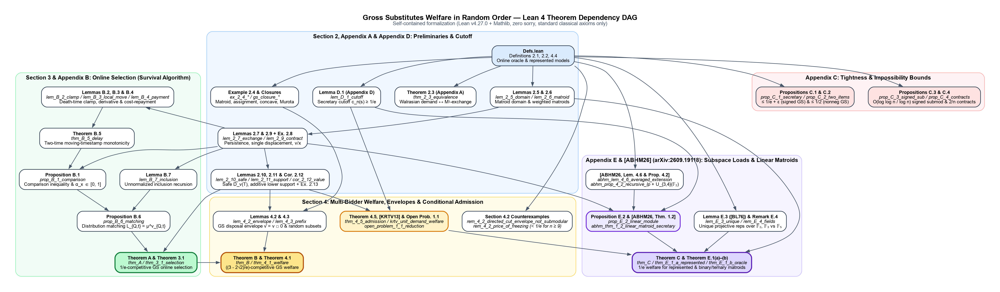
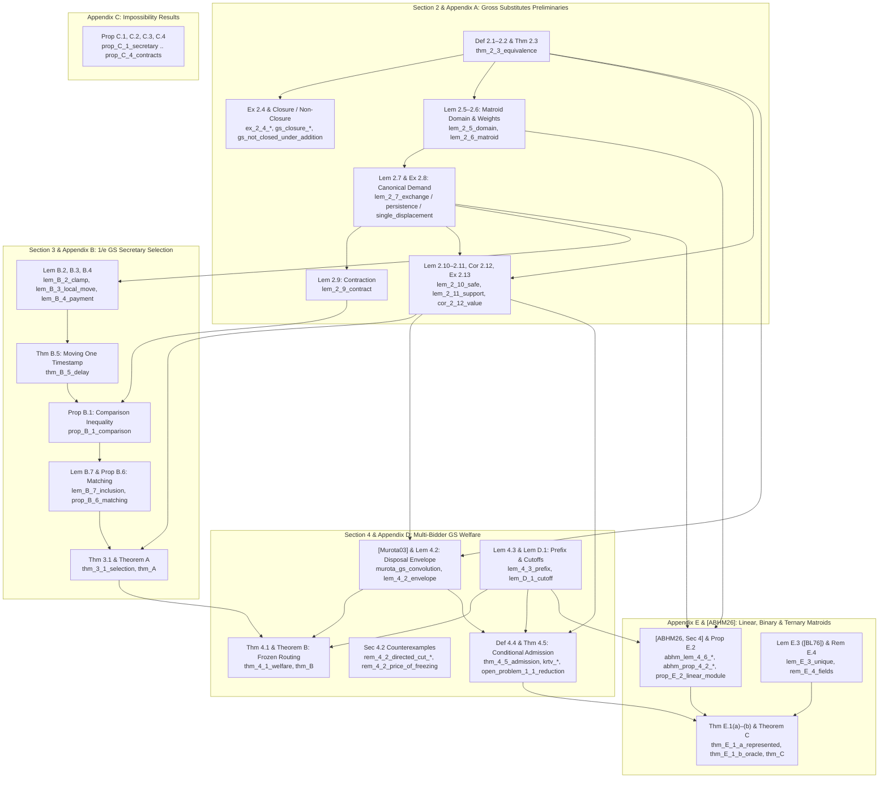

# Lean 4 Formalization of *Gross Substitutes Welfare in Random Order*

Complete, self-contained **Lean 4** (`leanprover/lean4:v4.27.0` + Mathlib `v4.27.0`) formalization of all definitions, examples, lemmas, propositions, corollaries, theorems, remarks, counterexamples, and external results in:

> **Gross Substitutes Welfare in Random Order**
> Renato Paes Leme, Martin Pál, and Neel Patel

Every theorem in this repository is kernel-verified with **zero `sorry`s**, **zero custom `axiom`s**, and **zero `native_decide`**, relying solely on Lean's three standard classical axioms (`propext`, `Classical.choice`, `Quot.sound`). All external results invoked by the paper—including Section 4 of Abdi, Banihashem, Hajiaghayi, and Mittal (`[ABHM26]`, `arXiv:2609.19118`), Fujishige–Yang / Shioura–Tamura (`[FY03, ST15]`), Murota (`[Murota03]`), Gul–Stacchetti (`[GS99]`), Lehmann–Lehmann–Nisan (`[LLN06]`), Kesselheim–Räcke–Tönnis–Vöcking (`[KRTV13]`), Gnedin / Correa et al. / Bateni et al. / Dynkin (`[Gnedin94, CDFS19, BHKKMO25, Dynkin63]`), Babaioff–Immorlica–Kleinberg / Rubinstein (`[BIK07, Rubinstein16]`), and Brylawski–Lucas (`[BL76]`)—are formalized and proved from first principles inside this package (42,786 lines across 17 Lean modules).

---

## Building and Verifying

### Prerequisites
- [`elan`](https://github.com/leanprover/elan) (automatically selects `leanprover/lean4:v4.27.0` from `lean-toolchain`).

### Build Commands
```bash
# Fetch precompiled Mathlib v4.27.0 cache (optional, speeds up first build)
lake exe cache get

# Compile and kernel-check the entire formalization
lake build
```

### Independent Axiom Audit
To verify directly in Lean's kernel that any theorem uses only `[propext, Classical.choice, Quot.sound]`:
```bash
lake env lean --stdin << 'EOF'
import GrossSubstitutesWelfare
#print axioms GrossSubstitutesWelfare.thm_A
#print axioms GrossSubstitutesWelfare.thm_B
#print axioms GrossSubstitutesWelfare.thm_C
#print axioms GrossSubstitutesWelfare.thm_2_3_equivalence
#print axioms GrossSubstitutesWelfare.thm_3_1_selection
#print axioms GrossSubstitutesWelfare.thm_4_1_welfare
#print axioms GrossSubstitutesWelfare.thm_4_5_admission
#print axioms GrossSubstitutesWelfare.prop_E_2_linear_module
#print axioms GrossSubstitutesWelfare.abhm_thm_1_2_linear_matroid_secretary
EOF
```

---

## Package Structure

```text
GrossSubstitutesWelfare/
├── README.md                                       # Paper-to-Lean map & dependency diagrams
├── dependency_diagram.png                          # High-resolution theorem dependency DAG
├── dependency_diagram.svg                          # Vector theorem dependency DAG
├── lean-toolchain                                  # leanprover/lean4:v4.27.0
├── lakefile.toml                                   # Lake package configuration
├── lake-manifest.json                              # Pinned Mathlib v4.27.0 manifest
├── GrossSubstitutesWelfare.lean                    # Root module importing all submodules
└── GrossSubstitutesWelfare/
    ├── Defs.lean                                   # Core definitions, online models, admission modules
    ├── Preliminaries/
    │   ├── PricesAndEquivalence.lean               # Def 2.1, Def 2.2, Thm 2.3 ([FY03, ST15])
    │   ├── ExchangeAndDemand.lean                  # Closure, Ex 2.4, Lem 2.5–2.7, Ex 2.8, Lem 2.9
    │   └── SafeSupportAndCutoff.lean               # Lem 2.10–2.11, Cor 2.12, Ex 2.13, Lem 4.3, Lem D.1
    ├── Selection/
    │   ├── ClampAndPayment.lean                    # App B.1: Two-time survival law, Lem B.2, B.3, B.4
    │   ├── DelayAndComparison.lean                 # App B.1: Thm B.5 (Delay) & Prop B.1 (Comparison)
    │   ├── DistributionMatching.lean               # App B.2–B.3: Prop B.6 (Matching) & Lem B.7 (Recursion)
    │   └── GSSelection.lean                        # Sec 1.1 Thm A & Sec 3 Thm 3.1 (1/e GS Selection)
    ├── Welfare/
    │   ├── EnvelopesAndBenchmarks.lean             # [Murota03] GS convolution, Lem 4.2, Ex 2.4 (rank/assign)
    │   ├── FrozenRouting.lean                      # Sec 1.1 Thm B & Sec 4 Thm 4.1 ((3-2√2)/e GS Welfare)
    │   └── ConditionalAdmission.lean               # Sec 4.2 counterexamples, Sec 4.3 Def 4.4, Thm 4.5, [KRTV13]
    ├── LinearMatroids/
    │   ├── ABHMSubspaceModule.lean                 # [ABHM26, Sec 4] (arXiv:2609.19118) & App E.1 Prop E.2
    │   ├── UniqueRepresentations.lean              # App E.2 Lem E.3 ([BL76] F₂/F₃ projective uniqueness)
    │   └── LinearMatroidWelfare.lean               # Sec 1.1 Thm C, App E Thm E.1(a)–(b), Rem E.4 (F₅)
    └── Impossibility/
        ├── SecretaryEmbedding.lean                 # App C Prop C.1 ([Gnedin94, CDFS19, BHKKMO25, Dynkin63])
        ├── TwoItemsAndContracts.lean               # App C Prop C.2 (Two items), Prop C.4, 1-bidder transfer
        └── SignedSubmodular.lean                   # App C Prop C.3 ([BIK07, Rubinstein16] O(log log n/log n))
```

---

## Dependency Diagram





---

## Complete Paper-to-Lean Correspondence Map

### Section 1.1: Main Results & Open Problem (`sec:results`)

| Paper Item | LaTeX Label | Lean Declaration(s) | Summary |
| :--- | :--- | :--- | :--- |
| **Theorem A** (Selection) | `thm:A` | [`thm_A`](GrossSubstitutesWelfare/Selection/GSSelection.lean#L2328) (`Selection/GSSelection.lean:2328`) | Universal `1/e`-competitive online selection algorithm for signed GS valuations; selects every `g ∈ D_v(N)` with probability `1/e` and keeps `v(A_k) ≥ 0` at every step. |
| **Theorem B** (Welfare) | `thm:B` | [`thm_B`](GrossSubstitutesWelfare/Welfare/FrozenRouting.lean#L2787) (`Welfare/FrozenRouting.lean:2787`) | Universal `((3 - 2√2) / e)`-competitive online welfare algorithm (*Frozen Routing*) for any `m` signed GS bidders with `v_i(A_i) ≥ 0` at all times. |
| **Theorem C** (Matroid welfare) | `thm:C` | [`thm_C`](GrossSubstitutesWelfare/LinearMatroids/LinearMatroidWelfare.lean#L7013) (`LinearMatroids/LinearMatroidWelfare.lean:7013`), [`thm_C_binary_oracle`](GrossSubstitutesWelfare/LinearMatroids/LinearMatroidWelfare.lean#L6947) (`LinearMatroids/LinearMatroidWelfare.lean:6947`), [`thm_C_ternary_oracle`](GrossSubstitutesWelfare/LinearMatroids/LinearMatroidWelfare.lean#L6962) (`LinearMatroids/LinearMatroidWelfare.lean:6962`), [`thm_C_mixed_oracle`](GrossSubstitutesWelfare/LinearMatroids/LinearMatroidWelfare.lean#L6977) (`LinearMatroids/LinearMatroidWelfare.lean:6977`), [`thm_C_represented`](GrossSubstitutesWelfare/LinearMatroids/LinearMatroidWelfare.lean#L6993) (`LinearMatroids/LinearMatroidWelfare.lean:6993`) | `1/e`-competitive online welfare for all-binary, all-ternary, and field-tagged binary/ternary weighted matroids in the value-oracle model, and finite-field linear matroids in the represented model. |
| **Question / Open Problem 1.1** (`1/e` for GS welfare — reduction) | `q:welfare` | [`open_problem_1_1_reduction`](GrossSubstitutesWelfare/Welfare/ConditionalAdmission.lean#L3456) (`Welfare/ConditionalAdmission.lean:3456`) | Formalizes the Section 4.3 reduction: conditional-admission modules for general GS valuations and proposal maps imply `1/e`-competitive multi-bidder GS welfare across all `n, m`. |

---

### Section 2 & Appendix A: Gross Substitutes Valuations (`sec:prelim`, `app:prelim`)

| Paper Item | LaTeX Label | Lean Declaration(s) | Summary |
| :--- | :--- | :--- | :--- |
| Valuations `v : 2^N → ℝ ∪ {-∞}`, domain `dom v`, allocations, `OPT` | `sec:prelim` | [`ItemValuation`](GrossSubstitutesWelfare/Defs.lean#L44) (`Defs.lean:44`), [`valDom`](GrossSubstitutesWelfare/Defs.lean#L51) (`Defs.lean:51`), [`IsAllocOf`](GrossSubstitutesWelfare/Defs.lean#L400) (`Defs.lean:400`), [`optVal`](GrossSubstitutesWelfare/Defs.lean#L63) (`Defs.lean:63`), [`optWelfare`](GrossSubstitutesWelfare/Defs.lean#L415) (`Defs.lean:415`) | Extended-real set valuations in `WithBot ℝ`, feasible domain, disjoint allocations, single-bidder `OPT(v)` and multi-bidder `OPT = W(N)`. |
| **Definition 2.1** (Gross substitutes via prices) | `def:gs-prices` | [`priceUtility`](GrossSubstitutesWelfare/Defs.lean#L71) (`Defs.lean:71`), [`priceDemand`](GrossSubstitutesWelfare/Defs.lean#L76) (`Defs.lean:76`), [`IsGSPrices`](GrossSubstitutesWelfare/Defs.lean#L80) (`Defs.lean:80`), [`priceDemand_nonempty`](GrossSubstitutesWelfare/Preliminaries/PricesAndEquivalence.lean#L1768) (`Preliminaries/PricesAndEquivalence.lean:1768`) | Kelso–Crawford demand correspondence `D(v, p)` and price-increase preservation property on `ℝ ∪ {-∞}`. |
| **Definition 2.2** (Exchange axiom / `M♮`-concavity) | `def:gs` | [`IsGSValuation`](GrossSubstitutesWelfare/Defs.lean#L88) (`Defs.lean:88`) | `v(∅) = 0` and single-item / `1`-for-`1` exchange inequality on `X, Y ∈ dom v` for every `x ∈ X \ Y`. |
| **Theorem 2.3** (Prices and exchanges) | `thm:equivalence` | [`thm_2_3_equivalence`](GrossSubstitutesWelfare/Preliminaries/PricesAndEquivalence.lean#L1788) (`Preliminaries/PricesAndEquivalence.lean:1788`) | Equivalence `IsGSPrices v ↔ IsGSValuation v` on extended-real valuations (`[FY03, ST15]`). |
| **Closure paragraph** & sum non-closure | `sec:exchange` | [`gs_closure_add_modular`](GrossSubstitutesWelfare/Preliminaries/ExchangeAndDemand.lean#L1343) (`Preliminaries/ExchangeAndDemand.lean:1343`), [`gs_closure_scale`](GrossSubstitutesWelfare/Preliminaries/ExchangeAndDemand.lean#L1363) (`Preliminaries/ExchangeAndDemand.lean:1363`), [`gs_closure_restrict`](GrossSubstitutesWelfare/Preliminaries/ExchangeAndDemand.lean#L1348) (`Preliminaries/ExchangeAndDemand.lean:1348`), [`gs_closure_dummy_item`](GrossSubstitutesWelfare/Preliminaries/ExchangeAndDemand.lean#L1353) (`Preliminaries/ExchangeAndDemand.lean:1353`), [`gs_closure_contract`](GrossSubstitutesWelfare/Preliminaries/ExchangeAndDemand.lean#L1358) (`Preliminaries/ExchangeAndDemand.lean:1358`), [`gs_not_closed_under_addition`](GrossSubstitutesWelfare/Welfare/EnvelopesAndBenchmarks.lean#L1905) (`Welfare/EnvelopesAndBenchmarks.lean:1905`) | Preservation under modular shifts, positive scaling, subset restriction, dummy items, and contraction (`v(∅) = 0`); explicit `3`-item complementarity counterexample showing GS is not closed under addition. |
| **Example 2.4** (GS valuation families) | `ex:gs` | [`IsUnitDemandValuation`](GrossSubstitutesWelfare/Defs.lean#L115) (`Defs.lean:115`), [`ex_2_4_matroid_rank`](GrossSubstitutesWelfare/Welfare/EnvelopesAndBenchmarks.lean#L1946) (`Welfare/EnvelopesAndBenchmarks.lean:1946`), [`ex_2_4_weighted_matroid_rank`](GrossSubstitutesWelfare/Welfare/EnvelopesAndBenchmarks.lean#L1955) (`Welfare/EnvelopesAndBenchmarks.lean:1955`), [`ex_2_4_assignment`](GrossSubstitutesWelfare/Welfare/EnvelopesAndBenchmarks.lean#L1964) (`Welfare/EnvelopesAndBenchmarks.lean:1964`), [`ex_2_4_concave_cardinality_with_prices`](GrossSubstitutesWelfare/Welfare/EnvelopesAndBenchmarks.lean#L1973) (`Welfare/EnvelopesAndBenchmarks.lean:1973`), [`ex_2_4_concave_cardinality`](GrossSubstitutesWelfare/Preliminaries/ExchangeAndDemand.lean#L1370) (`Preliminaries/ExchangeAndDemand.lean:1370`) | Unit-demand, matroid rank, nonnegative weighted matroid rank, bipartite assignment / OXS (`[LLN06]`), and concave cardinality functions plus modular prices are all GS. |
| **Lemma 2.5** (Matroid domain) | `lem:domain` | [`lem_2_5_domain`](GrossSubstitutesWelfare/Preliminaries/ExchangeAndDemand.lean#L1378) (`Preliminaries/ExchangeAndDemand.lean:1378`) | Downward-closed `dom v` of a GS valuation forms the independent sets of a matroid on `N` (and maximal elements of `dom v` form a matroid base family). |
| **Lemma 2.6** (Weighted matroids) | `lem:matroid` | [`lem_2_6_matroid`](GrossSubstitutesWelfare/Preliminaries/ExchangeAndDemand.lean#L1386) (`Preliminaries/ExchangeAndDemand.lean:1386`) | Signed weighted matroid valuations `v_M(S) = ∑_{g ∈ S} w_g` (`S ∈ ℐ(M)`, `-∞` otherwise) satisfy `IsGSValuation`. |
| **Section 2.2** (Canonical demands `D_v(T)`) | `sec:canonical` | [`psiWeight`](GrossSubstitutesWelfare/Defs.lean#L182) (`Defs.lean:182`), [`demandKeyLe`](GrossSubstitutesWelfare/Defs.lean#L186) (`Defs.lean:186`), [`canonicalDemand`](GrossSubstitutesWelfare/Defs.lean#L190) (`Defs.lean:190`), [`canonical_demand_spec`](GrossSubstitutesWelfare/Preliminaries/ExchangeAndDemand.lean#L1393) (`Preliminaries/ExchangeAndDemand.lean:1393`), [`psiWeight_card_lex_iff`](GrossSubstitutesWelfare/Preliminaries/ExchangeAndDemand.lean#L1404) (`Preliminaries/ExchangeAndDemand.lean:1404`) | Unique maximizer of `v` on `2^T` breaking ties by larger cardinality then lexicographically (`ψ(X) = ∑_{g ∈ X} (1 + 2^{-(g+1)})`). |
| **Lemma 2.7** (Single exchange, persistence & single displacement) | `lem:exchange` | [`lem_2_7_exchange`](GrossSubstitutesWelfare/Preliminaries/ExchangeAndDemand.lean#L1456) (`Preliminaries/ExchangeAndDemand.lean:1456`), [`lem_2_7_persistence`](GrossSubstitutesWelfare/Preliminaries/ExchangeAndDemand.lean#L1467) (`Preliminaries/ExchangeAndDemand.lean:1467`), [`lem_2_7_single_displacement`](GrossSubstitutesWelfare/Preliminaries/ExchangeAndDemand.lean#L1474) (`Preliminaries/ExchangeAndDemand.lean:1474`) | `D_v(T + x)` is `D_v(T)`, `D_v(T) + x`, or `D_v(T) - y + x`; implies persistence (`eq:persistence`) and single displacement (`eq:displacement`). |
| **Example 2.8** (No fixed priority) | `ex:assignment` | [`ex_2_8_assignment`](GrossSubstitutesWelfare/Preliminaries/ExchangeAndDemand.lean#L1482) (`Preliminaries/ExchangeAndDemand.lean:1482`) | `3`-item, `2`-slot assignment instance whose canonical demands on `{a,b}`, `{a,c}`, `{b,c}`, `{a,b,c}` rule out any fixed priority ordering. |
| **Lemma 2.9** (Contraction) | `lem:contract` | [`lem_2_9_contract`](GrossSubstitutesWelfare/Preliminaries/ExchangeAndDemand.lean#L1500) (`Preliminaries/ExchangeAndDemand.lean:1500`) | For `x ∈ D_v(S + x)`, `v({x}) ≥ 0`, `v / x` is GS on `N - x`, and `D_{v/x}(T) = D_v(T + x) - x` for all `T ⊆ S`. |
| **Lemma 2.10** (Safe region) & finite GS submodularity | `lem:safe` | [`lem_2_10_safe_a`](GrossSubstitutesWelfare/Preliminaries/SafeSupportAndCutoff.lean#L1040) (`Preliminaries/SafeSupportAndCutoff.lean:1040`), [`lem_2_10_safe_b`](GrossSubstitutesWelfare/Preliminaries/SafeSupportAndCutoff.lean#L1048) (`Preliminaries/SafeSupportAndCutoff.lean:1048`), [`lem_2_10_safe`](GrossSubstitutesWelfare/Preliminaries/SafeSupportAndCutoff.lean#L1056) (`Preliminaries/SafeSupportAndCutoff.lean:1056`), [`rem_2_10_finite_gs_submodular`](GrossSubstitutesWelfare/Preliminaries/SafeSupportAndCutoff.lean#L1067) (`Preliminaries/SafeSupportAndCutoff.lean:1067`) | Every `X ⊆ D_v(T)` has `v(X) ≥ 0` and monotone/submodular marginals on `2^{D_v(T)}`; finite-valued GS valuations are globally submodular (`[GS99]`). |
| **Lemma 2.11** (Additive lower support) | `lem:support` | [`lem_2_11_support`](GrossSubstitutesWelfare/Preliminaries/SafeSupportAndCutoff.lean#L1077) (`Preliminaries/SafeSupportAndCutoff.lean:1077`) | Order-based marginal vector `c_g = v(g | P_<g)` satisfies `c_g ≥ 0`, `∑_{g ∈ P} c_g = v(P)`, and `v(Y) ≥ ∑_{g ∈ Y} c_g` for all `Y ⊆ P ⊆ D_v(T)`. |
| **Corollary 2.12** (From inclusion to value) | `cor:value` | [`cor_2_12_value`](GrossSubstitutesWelfare/Preliminaries/SafeSupportAndCutoff.lean#L1089) (`Preliminaries/SafeSupportAndCutoff.lean:1089`), [`cor_2_12_value_subset`](GrossSubstitutesWelfare/Preliminaries/SafeSupportAndCutoff.lean#L1103) (`Preliminaries/SafeSupportAndCutoff.lean:1103`) | Random `A ⊆ D_v(N)` (or `A ⊆ P ⊆ D_v(T)`) with `P[g ∈ A] ≥ α` satisfies `E[v(A)] ≥ α OPT(v)` (resp. `α v(P)`). |
| **Example 2.13** (Random samples can destroy value) | `ex:sampling` | [`ex_2_13_sampling`](GrossSubstitutesWelfare/Preliminaries/SafeSupportAndCutoff.lean#L1158) (`Preliminaries/SafeSupportAndCutoff.lean:1158`) | Graphic matroid `K_{2, n-1}` with negative parallel edge weights where `OPT = 1` yet uniform sampling from `D_v(N)` has negative expected value. |

---

### Section 3 & Appendix B: Extending Huang's Algorithm to Gross Substitutes (`sec:selection`, `app:huang`)

| Paper Item | LaTeX Label | Lean Declaration(s) | Summary |
| :--- | :--- | :--- | :--- |
| Online selection protocol, survival law `μ^v_{S, t}`, acceptance `α_x` | `sec:algorithm`, `sec:survival` | [`OnlineSelectionAlg`](GrossSubstitutesWelfare/Defs.lean#L358) (`Defs.lean:358`), [`survivalLaw`](GrossSubstitutesWelfare/Defs.lean#L278) (`Defs.lean:278`), [`survivalAcceptProb`](GrossSubstitutesWelfare/Defs.lean#L293) (`Defs.lean:293`), [`survivalAcceptProb_valid`](GrossSubstitutesWelfare/Selection/DelayAndComparison.lean#L3108) (`Selection/DelayAndComparison.lean:3108`) | Non-clairvoyant value-oracle selection model, thought-experiment retention law `μ^v_{S,t}`, and acceptance rate `α_x(A,S,t) ∈ [0, 1]`. |
| **Theorem 3.1** (`1/e`-competitive GS selection) | `thm:selection` | [`thm_3_1_selection`](GrossSubstitutesWelfare/Selection/GSSelection.lean#L2304) (`Selection/GSSelection.lean:2304`) | Output law `μ^v_{N, 1}`, exact `1/e` marginal on `D_v(N)`, `A_k ⊆ D_v(T)` pointwise safety at every step, and `E[v(A)] ≥ OPT(v) / e`. |
| **Proposition B.1** (Comparison inequality) | `prop:comparison` | [`prop_B_1_comparison`](GrossSubstitutesWelfare/Selection/DelayAndComparison.lean#L3095) (`Selection/DelayAndComparison.lean:3095`) | For `x ∈ D_v(S + x)` and `t ∈ [1/e, 1]`, `μ^v_{S, t}(A) ≥ (1 / (e t)) μ^{v / x}_{S, t}(A)`. |
| Two-time generalized thought experiment | `sec:delay` | [`genSurvivalLaw2`](GrossSubstitutesWelfare/Defs.lean#L253) (`Defs.lean:253`), [`genMovingProb2`](GrossSubstitutesWelfare/Defs.lean#L260) (`Defs.lean:260`), [`genSurvivalLaw2_spec`](GrossSubstitutesWelfare/Selection/ClampAndPayment.lean#L1754) (`Selection/ClampAndPayment.lean:1754`) | Retention law on `S` (`τ_g ~ Unif[0, t_0]`) with deterministic items `B` at `β_b ∈ [1/e, t]` for `1/e ≤ t_0 ≤ t ≤ 1`. |
| **Lemma B.2** (Clamp) | `lem:clamp` | [`lem_B_2_clamp`](GrossSubstitutesWelfare/Selection/ClampAndPayment.lean#L1803) (`Selection/ClampAndPayment.lean:1803`), [`lem_B_2_clamp_choice_rule`](GrossSubstitutesWelfare/Selection/ClampAndPayment.lean#L1773) (`Selection/ClampAndPayment.lean:1773`) | Clamping deterministic arrival times from `[1/e, t]` down to `min(β_b, t_0)` preserves the retention law on `[0, t_0]^S`. |
| **Lemma B.3** (Local effect of the moving item) | `lem:local-move` | [`lem_B_3_local_move`](GrossSubstitutesWelfare/Selection/ClampAndPayment.lean#L1863) (`Selection/ClampAndPayment.lean:1863`), [`lem_B_3_local_move_choice_rule`](GrossSubstitutesWelfare/Selection/ClampAndPayment.lean#L1835) (`Selection/ClampAndPayment.lean:1835`) | Unique displaced item `y*(u) ∈ C(U_u^-) \ C(U_u^- + x)`, interval death-time shift on `[u_0, u_1)`, and invariance for all other items. |
| **Lemma B.4** (Cost and repayment) | `lem:payment` | [`lem_B_4_payment`](GrossSubstitutesWelfare/Selection/ClampAndPayment.lean#L1918) (`Selection/ClampAndPayment.lean:1918`), [`lem_B_4_payment_choice_rule`](GrossSubstitutesWelfare/Selection/ClampAndPayment.lean#L1894) (`Selection/ClampAndPayment.lean:1894`) | Pointwise identity `(1 - ϕ_τ^-(A))(u_1 - u_0) = ∫_{u_0}^{u_1} (ϕ_τ(A; τ̃) - ϕ_τ^-(A)) dτ̃ + ∫_{u_0}^{u_1} [y*(u) ∈ S_{1/e}] d_u(A) / (e u) du`. |
| **Theorem B.5** (Moving one timestamp) | `thm:delay` | [`thm_B_5_delay`](GrossSubstitutesWelfare/Selection/DelayAndComparison.lean#L3075) (`Selection/DelayAndComparison.lean:3075`), [`thm_B_5_delay_choice_rule`](GrossSubstitutesWelfare/Selection/DelayAndComparison.lean#L3058) (`Selection/DelayAndComparison.lean:3058`) | `τ̃ ↦ τ̃ μ̃(τ̃)` is nondecreasing on `[1/e, t_0]` for any persistent single-displacement choice rule `C` (and hence `D_v`). |
| **Proposition B.6** (Distribution matching) | `prop:matching` | [`prop_B_6_matching`](GrossSubstitutesWelfare/Selection/DistributionMatching.lean#L3709) (`Selection/DistributionMatching.lean:3709`) | Online survival-simulation law `L_{Q, t}` equals `μ^v_{Q, t}` for all `Q ⊆ N` and `t ∈ [1/e, 1]`. |
| **Lemma B.7** (Inclusion recursion) & pointwise safety | `lem:inclusion`, `sec:proof-selection` | [`lem_B_7_inclusion`](GrossSubstitutesWelfare/Selection/DistributionMatching.lean#L3694) (`Selection/DistributionMatching.lean:3694`), [`survival_pointwise_safe`](GrossSubstitutesWelfare/Selection/DistributionMatching.lean#L3682) (`Selection/DistributionMatching.lean:3682`) | Integral recursion for `m^v_{Q, A}(t) = t^{|Q|} P_{R ~ μ^v_{Q, t}}[A ⊆ R]` and support safety `μ^v_{S, t}(A) > 0 ⟹ ∃ T ⊆ S, A ⊆ D_v(T)`. |

---

### Section 4 & Appendix D: Multi-Bidder Welfare, Frozen Routing & Conditional Admission (`sec:welfare`, `app:cutoff`)

| Paper Item | LaTeX Label | Lean Declaration(s) | Summary |
| :--- | :--- | :--- | :--- |
| **Theorem 4.1** (Frozen routing welfare) | `thm:welfare` | [`thm_4_1_welfare`](GrossSubstitutesWelfare/Welfare/FrozenRouting.lean#L2766) (`Welfare/FrozenRouting.lean:2766`) | Frozen routing with coin bias `λ = √2 - 1` keeps `v_i(A_i) ≥ 0` at every step and achieves `E[∑_i v_i(A_i)] ≥ ((3 - 2√2) / e) OPT`. |
| **Lemma 4.2** (Disposal envelopes & `[Murota03]` convolution) | `lem:envelope` | [`murota_gs_convolution`](GrossSubstitutesWelfare/Welfare/EnvelopesAndBenchmarks.lean#L1915) (`Welfare/EnvelopesAndBenchmarks.lean:1915`), [`lem_4_2_envelope`](GrossSubstitutesWelfare/Welfare/EnvelopesAndBenchmarks.lean#L1925) (`Welfare/EnvelopesAndBenchmarks.lean:1925`), [`lem_4_2_envelope_optWelfare`](GrossSubstitutesWelfare/Welfare/EnvelopesAndBenchmarks.lean#L1938) (`Welfare/EnvelopesAndBenchmarks.lean:1938`) | Supremal convolution `u □ w` of GS valuations is GS; `v̄(S) = max_{T ⊆ S} v(T)` is finite, nonnegative, monotone, GS, submodular, and preserves `OPT`. |
| **Lemma 4.3** (Random subsets / prefix optimal welfare) | `lem:prefix` | [`lem_4_3_prefix`](GrossSubstitutesWelfare/Preliminaries/SafeSupportAndCutoff.lean#L1174) (`Preliminaries/SafeSupportAndCutoff.lean:1174`) | For `v_i(∅) = 0` and uniform `S` of size `k` (`|N| = n ≥ 1`), `E[W(S)] ≥ (k / n) OPT`. |
| **Section 4.2 Counterexample 1** (Why not submodular valuations) | `sec:routing` | [`rem_4_2_directed_cut_envelope_not_submodular`](GrossSubstitutesWelfare/Welfare/ConditionalAdmission.lean#L3358) (`Welfare/ConditionalAdmission.lean:3358`) | `3`-item directed-cut valuation that is finite, nonnegative, and submodular, yet whose disposal envelope `v̄` fails submodularity. |
| **Section 4.2 Counterexample 2** (The price of freezing) | `sec:routing` | [`rem_4_2_price_of_freezing`](GrossSubstitutesWelfare/Welfare/ConditionalAdmission.lean#L3373) (`Welfare/ConditionalAdmission.lean:3373`) | On `v_i(S) = |S| - 3(|S| - 1)_+`, frozen routing pools have expected envelope value `(λ(1 - λ) + (1 - λ)^2 / n) OPT ≤ (1/4 + 1/n) OPT < OPT / e` (`n ≥ 9`). |
| **Section 4.3** (Prefix proposals `X^S` & admission modules) | `sec:towards` | [`gsPrefixOptAlloc`](GrossSubstitutesWelfare/Defs.lean#L511) (`Defs.lean:511`), [`gsPrefixOptAlloc_spec`](GrossSubstitutesWelfare/Welfare/ConditionalAdmission.lean#L3393) (`Welfare/ConditionalAdmission.lean:3393`), [`gsPrefixOptAlloc_proposal`](GrossSubstitutesWelfare/Welfare/ConditionalAdmission.lean#L3405) (`Welfare/ConditionalAdmission.lean:3405`), [`IsProposalMap`](GrossSubstitutesWelfare/Defs.lean#L524) (`Defs.lean:524`), [`OnlineAdmissionModule`](GrossSubstitutesWelfare/Defs.lean#L555) (`Defs.lean:555`), [`IsAdmissionModuleFor`](GrossSubstitutesWelfare/Defs.lean#L585) (`Defs.lean:585`) | Canonical prefix-optimal allocation `X^S` depends only on subsets of `S` and defines valid GS proposal maps `P_i(S) = X^S_i ⊆ D_{v_i}(S)`. |
| **Definition 4.4** (Conditional admission) | `def:admission` | [`HasConditionalAdmission`](GrossSubstitutesWelfare/Defs.lean#L599) (`Defs.lean:599`) | Conditional admission probability `≥ a_k = s / (k - 1)` for `g_k ∈ P(S_k)` (`k > s`) and prefix credit lower bound `E[v(A)] ≥ E[∑_{k > s} c_{S_k}(g_k) 1_{g_k ∈ A}]`. |
| **Theorem 4.5** (Conditional admission implies welfare) | `thm:admission` | [`thm_4_5_admission`](GrossSubstitutesWelfare/Welfare/ConditionalAdmission.lean#L3418) (`Welfare/ConditionalAdmission.lean:3418`) | Running conditional-admission modules side by side against `P_i(S) = X^S_i` yields a valid `OnlineWelfareAlg` with `E[∑_i v_i(A_i)] ≥ c_n(s) OPT`. |
| **Section 4.3** (`[KRTV13]` unit-demand instantiation) | `sec:towards` | [`krtv_unit_demand_module`](GrossSubstitutesWelfare/Welfare/ConditionalAdmission.lean#L3434) (`Welfare/ConditionalAdmission.lean:3434`), [`krtv_unit_demand_welfare`](GrossSubstitutesWelfare/Welfare/ConditionalAdmission.lean#L3445) (`Welfare/ConditionalAdmission.lean:3445`) | First-accepted-offer module satisfies Definition 4.4 for unit-demand bidders, giving `OPT / e` across all `n, m`. |
| **Lemma D.1** (Choosing the cutoff `c_n(s) ≥ 1/e`) | `lem:cutoff` | [`lem_D_1_cutoff`](GrossSubstitutesWelfare/Preliminaries/SafeSupportAndCutoff.lean#L1185) (`Preliminaries/SafeSupportAndCutoff.lean:1185`) | Exact Riemann-sum / log proof that for every `n ≥ 2` there exists `s ∈ {1, ..., n - 1}` with `c_n(s) = (s/n) ∑_{j=s}^{n-1} (1/j) ≥ 1 / e`. |

---

### Appendix C: Impossibility Results (`app:lower`)

| Paper Item | LaTeX Label | Lean Declaration(s) | Summary |
| :--- | :--- | :--- | :--- |
| Single-bidder welfare-to-selection transfer | `app:lower` | [`welfareAlgToSelectionAlg`](GrossSubstitutesWelfare/Impossibility/TwoItemsAndContracts.lean#L1411) (`Impossibility/TwoItemsAndContracts.lean:1411`), [`rem_C_single_bidder_transfer`](GrossSubstitutesWelfare/Impossibility/TwoItemsAndContracts.lean#L1450) (`Impossibility/TwoItemsAndContracts.lean:1450`) | Exact `m = 1` correspondence transferring single-bidder selection lower bounds to multi-bidder welfare algorithms. |
| **Proposition C.1** (Secretary embedding) | `prop:secretary` | [`prop_C_1_secretary`](GrossSubstitutesWelfare/Impossibility/SecretaryEmbedding.lean#L2592) (`Impossibility/SecretaryEmbedding.lean:2592`) | No online selection algorithm on `{0, 1}` unit-demand valuations has competitive ratio `1/e + ε` for infinitely many `n` (`[Gnedin94, CDFS19, BHKKMO25, Dynkin63]`). |
| **Proposition C.2** (Two items) | `prop:two-items` | [`prop_C_2_two_items`](GrossSubstitutesWelfare/Impossibility/TwoItemsAndContracts.lean#L1379) (`Impossibility/TwoItemsAndContracts.lean:1379`) | On `2` items with unit-demand `v`, every non-clairvoyant algorithm preserving `v(A_k) ≥ 0` obtains `≤ OPT(v) / 2` on `(-1, M)` or `(1, 0)`. |
| **Proposition C.3** (Signed submodular functions) | `prop:signed-sub` | [`prop_C_3_signed_sub`](GrossSubstitutesWelfare/Impossibility/SignedSubmodular.lean#L1182) (`Impossibility/SignedSubmodular.lean:1182`) | Disjoint-groups signed submodular family forcing `E[v(A)] ≤ (85 log(1 + log n) / log n) OPT` (`o(1)` as `n → ∞`, `[BIK07, Rubinstein16]`). |
| **Proposition C.4** (No per-pair guarantee) | `prop:contracts` | [`prop_C_4_contracts`](GrossSubstitutesWelfare/Impossibility/TwoItemsAndContracts.lean#L1393) (`Impossibility/TwoItemsAndContracts.lean:1393`) | For every `c > 0`, large `2`-bidder unit-demand instance (`n = m + 1`) where every algorithm gives some optimal pair `(i, g)` probability `< c`. |

---

### Appendix E: Welfare with Linear Matroid Bidders (`sec:linear`)

| Paper Item | LaTeX Label | Lean Declaration(s) | Summary |
| :--- | :--- | :--- | :--- |
| **Theorem E.1(a)** (Represented matroid welfare) | `thm:linear` | [`thm_E_1_a_represented`](GrossSubstitutesWelfare/LinearMatroids/LinearMatroidWelfare.lean#L6884) (`LinearMatroids/LinearMatroidWelfare.lean:6884`) | `c_n(s) OPT` welfare in the represented model for weighted linear matroids over arbitrary finite fields `𝔽_1, ..., 𝔽_m`. |
| **Theorem E.1(b)** & Weighted Rank Corollary (Value-oracle model) | `thm:linear`, `sec:linear` | [`thm_E_1_b_oracle`](GrossSubstitutesWelfare/LinearMatroids/LinearMatroidWelfare.lean#L6905) (`LinearMatroids/LinearMatroidWelfare.lean:6905`), [`thm_E_1_b_weighted_rank`](GrossSubstitutesWelfare/LinearMatroids/LinearMatroidWelfare.lean#L6926) (`LinearMatroids/LinearMatroidWelfare.lean:6926`) | `c_n(s) OPT` welfare in the value-oracle model for `𝔽_i ∈ {𝔽_2, 𝔽_3}` (both signed `weightedMatroidVal` and nonnegative `weightedMatroidRankVal`). |
| **Proposition E.2** (Arbitrary proposals for linear matroids) | `prop:linear-module` | [`prop_E_2_linear_module`](GrossSubstitutesWelfare/LinearMatroids/ABHMSubspaceModule.lean#L3665) (`LinearMatroids/ABHMSubspaceModule.lean:3665`) | Universal `RepresentedAdmissionModule` achieving exact conditional admission `a_k = s / (k - 1)` for every `g ∈ P(S)` on any independent proposal map `P`. |
| **Lemma E.3** (Unique `𝔽_2` and `𝔽_3` representations) | `lem:unique` | [`lem_E_3_unique`](GrossSubstitutesWelfare/LinearMatroids/UniqueRepresentations.lean#L1828) (`LinearMatroids/UniqueRepresentations.lean:1828`), [`lem_E_3_unique_binary`](GrossSubstitutesWelfare/LinearMatroids/UniqueRepresentations.lean#L1795) (`LinearMatroids/UniqueRepresentations.lean:1795`), [`lem_E_3_unique_ternary`](GrossSubstitutesWelfare/LinearMatroids/UniqueRepresentations.lean#L1813) (`LinearMatroids/UniqueRepresentations.lean:1813`) | Arrived independence oracle uniquely determines `𝔽_2` linear representations and projectively uniquely determines `𝔽_3` representations (`[BL76]`). |
| **Remark E.4** (Larger fields `𝔽_5` failure) | `rem:fields` | [`rem_E_4_fields`](GrossSubstitutesWelfare/LinearMatroids/LinearMatroidWelfare.lean#L7063) (`LinearMatroids/LinearMatroidWelfare.lean:7063`) | Projectively inequivalent `𝔽_5` representations of `U_{3, 6}` where `μ` is `2/3`-bounded in `R'` yet has zero extension availability on `h = (1, 0, 3) ≠ 0` in `R`. |

---

## Self-Contained Formalization of External Papers

All external theorems invoked in *Gross Substitutes Welfare in Random Order* are proved from scratch in Lean 4 within this package:

| External Reference | External Result | Lean Declaration(s) |
| :--- | :--- | :--- |
| **Abdi, Banihashem, Hajiaghayi & Mittal (`[ABHM26]`, `arXiv:2609.19118`)** | Section 4.2: Subspace loads `ℓ_U(A) = dim(W(A) ∩ U)` and equivalence of `β`-boundedness over `U ≤ F^d` vs arrived subspaces `U ≤ W(S)` | [`abhm_arrived_span_iff`](GrossSubstitutesWelfare/LinearMatroids/ABHMSubspaceModule.lean#L3591) (`LinearMatroids/ABHMSubspaceModule.lean:3591`) |
| **Abdi, Banihashem, Hajiaghayi & Mittal (`[ABHM26]`, `arXiv:2609.19118`)** | Section 4.2: Hidden-direction separation on `U_{3, 4}(𝔽_2)` (`3/4` on item-spanned flats `W(X)` vs failure of `β < 1` on `U ≤ 𝔽_2^3`) | [`abhm_hidden_directions_F2`](GrossSubstitutesWelfare/LinearMatroids/ABHMSubspaceModule.lean#L3605) (`LinearMatroids/ABHMSubspaceModule.lean:3605`) |
| **Abdi, Banihashem, Hajiaghayi & Mittal (`[ABHM26]`, `arXiv:2609.19118`)** | **Lemma 4.6**: Averaged extension lemma for arbitrary linearly independent proposal sets `B ⊆ S` over finite fields (via subspace uncrossing & chain admission) | [`abhm_lem_4_6_averaged_extension`](GrossSubstitutesWelfare/LinearMatroids/ABHMSubspaceModule.lean#L3620) (`LinearMatroids/ABHMSubspaceModule.lean:3620`) |
| **Abdi, Banihashem, Hajiaghayi & Mittal (`[ABHM26]`, `arXiv:2609.19118`)** | **Definition 4.1 & Proposition 4.2**: Feasibility & `(1 - s / |S|)`-boundedness of recursive prefix program `(P_S)` depending only on arrived vectors & prefix proposals | [`abhm_prop_4_2_recursive_lp`](GrossSubstitutesWelfare/LinearMatroids/ABHMSubspaceModule.lean#L3644) (`LinearMatroids/ABHMSubspaceModule.lean:3644`) |
| **Abdi, Banihashem, Hajiaghayi & Mittal (`[ABHM26]`, `arXiv:2609.19118`)** | **Algorithm 1 & Lemma 4.7**: Non-clairvoyant online simulation matching `(P_S)` prefix laws and conditional admission `s / (k - 1)` | [`prop_E_2_linear_module`](GrossSubstitutesWelfare/LinearMatroids/ABHMSubspaceModule.lean#L3665) (`LinearMatroids/ABHMSubspaceModule.lean:3665`) |
| **Abdi, Banihashem, Hajiaghayi & Mittal (`[ABHM26]`, `arXiv:2609.19118`)** | **Proposition 4.3 & Theorem 1.2**: Strong Matroid Secretary Conjecture for Linear Matroids (`c_n(s) ≥ 1/e` exact inclusion probability for every element of `D_{v_M}(N)`) | [`abhm_thm_1_2_linear_matroid_secretary`](GrossSubstitutesWelfare/LinearMatroids/ABHMSubspaceModule.lean#L3695) (`LinearMatroids/ABHMSubspaceModule.lean:3695`) |
| **Fujishige & Yang (`[FY03]`), Shioura & Tamura (`[ST15]`)** | Equivalence of Kelso–Crawford gross substitutes prices and `M♮`-concavity exchange axiom on `ℝ ∪ {-∞}` | [`thm_2_3_equivalence`](GrossSubstitutesWelfare/Preliminaries/PricesAndEquivalence.lean#L1788) (`Preliminaries/PricesAndEquivalence.lean:1788`) |
| **Murota (`[Murota03]`)** | Supremal convolution `u □ w` of `M♮`-concave (GS) valuations preserves GS, implying disposal envelopes `v̄ = v □ 0` are GS | [`murota_gs_convolution`](GrossSubstitutesWelfare/Welfare/EnvelopesAndBenchmarks.lean#L1915) (`Welfare/EnvelopesAndBenchmarks.lean:1915`), [`lem_4_2_envelope`](GrossSubstitutesWelfare/Welfare/EnvelopesAndBenchmarks.lean#L1925) (`Welfare/EnvelopesAndBenchmarks.lean:1925`) |
| **Gul & Stacchetti (`[GS99]`)** | Finite-valued gross substitutes valuations are submodular | [`rem_2_10_finite_gs_submodular`](GrossSubstitutesWelfare/Preliminaries/SafeSupportAndCutoff.lean#L1067) (`Preliminaries/SafeSupportAndCutoff.lean:1067`) |
| **Lehmann, Lehmann & Nisan (`[LLN06]`)** | Bipartite assignment (OXS) valuations satisfy gross substitutes | [`ex_2_4_assignment`](GrossSubstitutesWelfare/Welfare/EnvelopesAndBenchmarks.lean#L1964) (`Welfare/EnvelopesAndBenchmarks.lean:1964`) |
| **Kesselheim, Räcke, Tönnis & Vöcking (`[KRTV13]`)** | Optimal `1/e`-competitive online bipartite matching / unit-demand welfare via prefix matching + cutoff | [`krtv_unit_demand_module`](GrossSubstitutesWelfare/Welfare/ConditionalAdmission.lean#L3434) (`Welfare/ConditionalAdmission.lean:3434`), [`krtv_unit_demand_welfare`](GrossSubstitutesWelfare/Welfare/ConditionalAdmission.lean#L3445) (`Welfare/ConditionalAdmission.lean:3445`) |
| **Gnedin (`[Gnedin94]`), Correa et al. (`[CDFS19]`), Bateni et al. (`[BHKKMO25]`), Dynkin (`[Dynkin63]`)** | Finite-Ramsey Game of Googol transfer from unknown real values to `{0, 1}` secretary lower bound `1/e` | [`prop_C_1_secretary`](GrossSubstitutesWelfare/Impossibility/SecretaryEmbedding.lean#L2592) (`Impossibility/SecretaryEmbedding.lean:2592`) |
| **Babaioff, Immorlica & Kleinberg (`[BIK07]`), Rubinstein (`[Rubinstein16]`)** | `O(log log n / log n)` impossibility for online selection with signed submodular valuations | [`prop_C_3_signed_sub`](GrossSubstitutesWelfare/Impossibility/SignedSubmodular.lean#L1182) (`Impossibility/SignedSubmodular.lean:1182`) |
| **Brylawski & Lucas (`[BL76]`)** | Projective uniqueness of `𝔽_2` and `𝔽_3` linear matroid representations (fundamental-circuit / `2×2` minor rigidity) | [`lem_E_3_unique`](GrossSubstitutesWelfare/LinearMatroids/UniqueRepresentations.lean#L1828) (`LinearMatroids/UniqueRepresentations.lean:1828`) |
